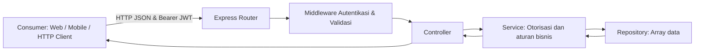

# Arsitektur dan kontrak SIMADU API

| Metode | Endpoint | Akses | Respons sukses |
|---|---|---|---|
| POST | /api/auth/login | Publik | 200 |
| GET | /api/pengaduan | Mahasiswa (milik sendiri), Admin (semua) | 200 |
| GET | /api/pengaduan/:id | Pemilik atau Admin | 200 |
| POST | /api/pengaduan | Mahasiswa | 201 |
| PUT | /api/pengaduan/:id | Pemilik saat diajukan | 200 |
| PATCH | /api/pengaduan/:id/status | Admin | 200 |
| DELETE | /api/pengaduan/:id | Pemilik saat diajukan | 200 |

Contoh request POST pengaduan: `{ "judul":"Wifi rusak", "kategori":"TI", "deskripsi":"Koneksi sering terputus" }`. Contoh respons: `{ "success":true, "data": { "id":3, "mahasiswaId":"M001", "judul":"Wifi rusak", "kategori":"TI", "deskripsi":"Koneksi sering terputus", "status":"diajukan", "createdAt":"2026-11-26T01:00:00.000Z" } }`.

Status HTTP: 200 (berhasil), 201 (dibuat), 400 (validasi), 401 (belum login / token gagal), 403 (tidak berhak), 404 (tidak ditemukan), 500 (internal). Semua respons menggunakan `success` dan `data` atau `error`.

**Router** memetakan URL ke handler; **controller** mengelola request/response; **service** menyimpan aturan bisnis dan hak akses; **repository** mengelola data; **middleware** memeriksa JWT dan kesalahan umum.

**Catatan teknis:** database array reset ketika server restart; ini hanya sesuai kebutuhan demo UTS, bukan implementasi produksi.
